# Real-Time, Multi-Function ADAS & Autonomous Driving Suite

[](https://sciforum.net/event/ecsa-13)
[](https://beamng.tech/)
[](https://www.raspberrypi.com/products/raspberry-pi-5/)
[]()
[](LICENSE)
[](https://github.com/Erusuru/ADAS-RealTime-MultiFunction/stargazers)
[](https://github.com/Erusuru/ADAS-RealTime-MultiFunction/commits/main)

> [!IMPORTANT]
> ### Accepted for Publication — MDPI (Basel, Switzerland)
> Our research paper has been officially accepted by the Scientific Committee of MDPI Switzerland:
> 
> - **Title:** *"Design and simulation evaluation of an embedded multi-sensor ADAS architecture with AI-assisted collision warning"*  
> - **Publisher:** **MDPI AG** (*Basel, Switzerland*) — Published in [***Engineering Proceedings***](https://www.mdpi.com/journal/engproc) (ISSN 2673-4591)  
> - **Conference:** [**The 13th International Electronic Conference on Sensors and Applications (ECSA-13)**](https://sciforum.net/event/ecsa-13) (18–20 November 2026)  
> - **Session:** *S4. Sensors and Artificial Intelligence* | **Submission ID:** `Sciforum-195321`  
> - **Authors:** **Ramazan Ertuğrul Aydoğan\*** *(GAÜN)*, **Fatima Sapundzhi\*** *(SWU)*  
>
> *See the [Related Publication](#related-publication) section below for full citation details.*

**Lead Developer:** Ramazan Ertuğrul Aydoğan  
**Affiliation:** *Department of Electrical and Electronics Engineering, Gaziantep University (GAÜN), Gaziantep, Türkiye*  
**Academic Supervisor:** Prof. Dr. Uğur Cem Hasar — *Department of EEE, Gaziantep University (GAÜN)*  
**Co-author:** Fatima Sapundzhi — *South-West University "Neofit Rilski", Blagoevgrad, Bulgaria*  
**Sponsor:** **BeamNG GmbH** *(Official Academic Research License)* &nbsp;&nbsp;

---

> [!NOTE]
> ### Major Release: BeamNG Pilot V31 (Smooth Overtaking, Minimum-Jerk Trajectory & Shadow Mode)
> 
> **BeamNG Pilot V31** advances closed-loop simulation by solving high-speed overtake dynamics, trajectory discontinuities, and autonomous data collection:
> 
> - **Quintic Minimum-Jerk Trajectory Planning ($S(t) = 10t^3 - 15t^4 + 6t^5$):** Replaces abrupt lateral steps with $C^2$-continuous polynomial trajectory synthesis ($S'(0)=S'(1)=0, S''(0)=S''(1)=0$). Overtakes and obstacle bypass maneuvers execute with zero lateral jerk, eliminating suspension rocking and vehicle instability.
> - **BEV Lane Fitter Slot Continuity:** Eliminates discontinuous $\pm 3.66\text{m}$ lateral jumps during passing maneuvers, ensuring mathematically smooth lane transitions.
> - **Speed-Adaptive Horizons:** Lookahead distance dynamically expands by 55–85m at highway speeds, and maneuver duration scales between 3.0s and 4.5s (replacing the violent 1.85s fixed window).
> - **Bilateral Overtaking Decisions:** Executes both left-side passing and right-side bypass based on spatial clearance and oncoming corridor arbitration.
> - **Steering Authority Softening:** Damps cross-track gains during active maneuvers (`maneuver_active=True`) to prevent over-correction.
> - **Proven V29 Quadratic Geometry Baseline:** Restores strict rejection of implausible lane fits, eliminating the V30pro clamp/refit artifacts that grabbed adjacent roads.
> - **Multi-Tier ESC Separation:** Safe and Aggressive driving modes strictly utilize the proven rock-solid V29 envelope, while Track mode retains aggressive V30pro high-speed drift experimentation.
> - **BeamNG Pilot V31 PRO (Touch-Free Shadow Mode & RL Suite):** Runs 100% in the background without touching vehicle controls, recording human driving inputs, AI shadow calculations, detailed lane/object metrics, and reinforcement learning rewards for offline imitation and policy training.
> 
> *(Note: `beamng_pilot_v31 - Copy.py` represents the verified stable production baseline of V31, while `beamng_pilot_v31.py` is actively receiving TensorRT `.engine` auto-discovery on RTX 5060, emerald green/orange lane departure ribbon HUD, and dual-border road-edge fallback rendering).*

---

> [!TIP]
> ### Real-Car Deployment: ZED ADAS Realtime V4 & Raspberry Pi Embedded Edge Suite
> 
> For physical vehicle testing (SAE Level 0 Driver Warning), the system deploys a decoupled dual-node architecture:
> 
> 1. **Production Laptop Perception Node (`zed2_realcar_adas4.py`):**
>    - **Stereolabs ZED 2 / ZED 2i Stereo Vision:** Multi-cue sub-pixel depth extraction combining dense disparity, StereoSGBM, and 1D Parabolic Sub-Pixel Epipolar NCC refiner (~0.02 px precision, **0.01m accuracy under 15m**), complete with live laser rangefinder reticle and click-to-measure 3D probe.
>    - **Cube Orange + Dual Here 3 GNSS / IMU Fusion:** USB MAVLink auto-discovery (skipping SLCAN), EKF ground speed, heading, longitudinal acceleration, and IMU yaw-rate road curvature compensation.
>    - **Accelerated Dual Perception on RTX 5060:** CUDA-accelerated TwinLiteNet (stretched above-hood road tensor) + YOLOv12s / RT-DETR TensorRT FP16 engine with dynamic runtime input scaling.
>    - **Safety Logic:** Multi-tier Forward Collision Warning (FCW), Headway Monitoring Warning (HMW), Stopped-Ego Hysteresis, Lead Vehicle Departure Alert (LVDA), Cut-In & T-Bone cross-traffic prediction, and Lane Departure Warning (LDW).
> 2. **Raspberry Pi Embedded Companion System (`raspberry_pi_adas_hardware.py` / `pi_driver_monitor.py`):**
>    - **Hardware Platform:** Raspberry Pi 4B / Pi 5 (Bookworm 64-bit) with 7" Waveshare 1024×600 touchscreen.
>    - **In-Cabin Driver Monitoring System (DMS):** MediaPipe Face Mesh on CPU tracking Eye Aspect Ratio (EAR), PERCLOS, Mouth Aspect Ratio (MAR yawn detection), and 3D head pose nodding.
>    - **Direct Ethernet Link (CAT6, 192.168.50.x):** UDP JSON state broadcast (Port 5005) received by `zed2_realcar_adas4.py` (`PiStateListener`) to dynamically boost FCW sensitivity (`--pi-boost`) during driver inattention or drowsiness; HTTP MJPEG video stream (Port 8080) for remote driver viewing via `pi_stream_viewer.py`.
>    - **Physical Automotive Controls:** Ambient light photoresistor (LDR) with dual-threshold hysteresis relay (30% ON, 50% OFF) for automatic headlights, L298N actuator power cutoff for emergency micro-sleep engine shutdown, and MQ-3 alcohol sensor for anti-DUI lock.

---

## Table of Contents

- [Visual Showcase: Live Autopilot & Vision Detections](#visual-showcase-live-autopilot--vision-detections)
- [Master Demonstration Video Library](#master-demonstration-video-library)
- [Why This Project](#why-this-project)
- [System Architecture & Hardware Nodes](#system-architecture--hardware-nodes)
- [Project Evolution & Version History (V1 – V31)](#project-evolution--version-history-v1--v31)
- [Real-World ZED 2 + Cube Orange Perception](#real-world-zed-2--cube-orange-perception)
- [Performance Benchmarks (113 Scenarios)](#performance-benchmarks-113-manually-reviewed-scenarios)
- [Automated Benchmark (2,844 Nexar Sequences)](#automated-benchmark-2844-nexar-derived-sequences)
- [Custom-Trained YOLO12s Models](#custom-trained-yolo12s-models)
- [Android Companion App](#android-companion-app)
- [Bill of Materials (BOM)](#bill-of-materials-bom)
- [Related Publication & Citation](#related-publication)
- [Academic Context, Supervision & Acknowledgements](#academic-context--supervision)
- [About the Lead Developer](#about-the-lead-developer)
- [License](#license)

---

## Visual Showcase: Live Autopilot & Vision Detections

Below are high-frame-rate animated previews capturing key real-world detection, tracking, and closed-loop simulation moments across diverse accident typologies, adverse weather/lighting, and autopilot maneuvers.

### Featured Full Presentations
- ⭐ **[`ADAS_ORET_Community_Showcase_Full_1080p.mp4`](assets/videos/ADAS_ORET_Community_Showcase_Full_1080p.mp4) — Master 1080p Showcase Compilation (`2m 14s`):** Comprehensive engineering presentation video combining real-world deep learning perception with BeamNG.tech closed-loop autonomous dynamics (TEKNOFEST Robotaksi Proving Ground replica, Custom ESC oversteer slide recovery at 92 km/h, Utah Canyon cruise & tunnel transit, Level 2 AEB 85% energy dissipation). Prepared for ORET Community Presentation.
- 📱 **[`ADAS_Instagram_Story_9x16.mp4`](assets/videos/ADAS_Instagram_Story_9x16.mp4) — 9:16 Vertical Story / Reels Showcase (`52s`, 1080×1920):** Specially formatted vertical showcase video optimized for mobile platforms (Instagram Story / Reels / Shorts). Features exclusively BeamNG.tech closed-loop simulation scenarios rendered with zoomed vertical framing (>52% canvas coverage) and live telemetry HUD cards: (1) 92 km/h overspeed curve crash avoidance with custom ESC yaw stabilization, (2) V29 Utah highway viaduct cruise & dark subterranean tunnel full loop with zero oscillation, and (3) TEKNOFEST Robotaksi course detour swerve, 90° intersection turn, and automated precision parking.

---

### Closed-Loop Simulation Autopilot (BeamNG.tech)

| Overspeed Curve Slide & Custom ESC (92 → 61 km/h) | TEKNOFEST Robotaksi: Detour, 90° Turn & Park |
|:---:|:---:|
| 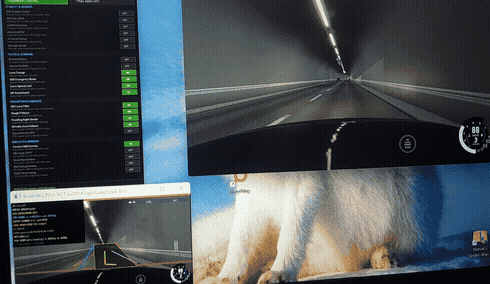 | 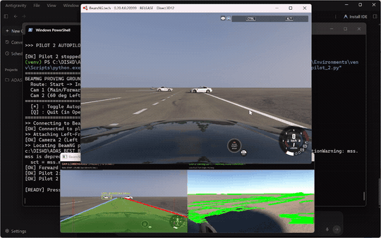 |
| **Driver Fault Overspeed & Dynamic Stability Recovery:** Vehicle enters a sharp subterranean curve at **92 km/h**, triggering an uncontrolled oversteer slide toward the tunnel wall. The ADAS system intervenes autonomously via custom **Electronic Stability Control (ESC)** and emergency deceleration (**`BRAKE 100%`**), shedding velocity down to **75 km/h**, regaining front axle grip, executing rapid counter-steering recovery (**`STR +0.252` to `+0.550`**, lateral acceleration up to **`0.79g`**), slowing safely to **61 km/h**, and re-centering smoothly into the host lane.<br>▶️ [`sitl_08_beamng_overspeed_curve_esc_stabilization.mp4`](assets/videos/sitl_08_beamng_overspeed_curve_esc_stabilization.mp4) | **TEKNOFEST Robotaksi Proving Ground Digital Twin:** Multi-camera perception (`Cam 1 Forward` + `Cam 2 60° Left`) detects a stationary obstacle vehicle blocking the lane (`LEFT [AHEAD] Dist: 24.6m -> 11.1m`), executes an autonomous dynamic lane-change maneuver to overtake the obstruction, tracks lane markings into an intersection, executes an automated 90-degree left turn guided by road-continuity segmentation, and performs a precision automated target parking stop (`State: FINAL_STOP`).<br>▶️ [`demo_sitl_beamng_teknofest_robotaksi_obstacle_avoidance_turn_park.mp4`](assets/videos/demo_sitl_beamng_teknofest_robotaksi_obstacle_avoidance_turn_park.mp4) |

| Utah Canyon Highway Viaduct Cruise (`74 km/h`) | Utah Mountain Tunnel Low-Light Transit (`71 km/h`) |
|:---:|:---:|
| 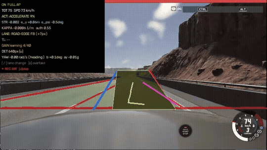 | 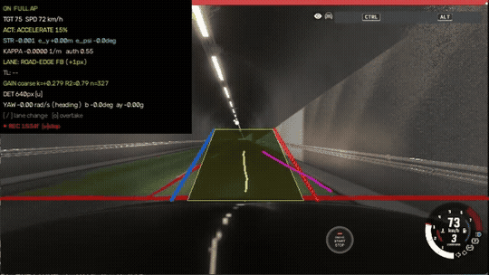 |
| **High-Speed Closed-Loop Highway Cruise:** Operating in **`ON FULL AP`** mode at **74 km/h** across the Utah Canyon viaduct bridge. Demonstrates zero-drift lateral error correction (`STR -0.007 DEV -3px`), active road edge feedback (`ROAD-EDGE FB`), and smooth continuous steering stabilization at highway speeds.<br>▶️ [`sitl_05_beamng_utah_highspeed_highway_bridge.mp4`](assets/videos/sitl_05_beamng_utah_highspeed_highway_bridge.mp4) | **Subterranean Tunnel & Lighting Transition:** Host vehicle transitions from open daylight into an unlit mountain tunnel under sodium lamp glare at **71 km/h**. Drivable corridor segmentation retains lane lock without GPS or map priors, maintaining smooth sub-pixel steering regulation through abrupt illumination drop.<br>▶️ [`sitl_06_beamng_utah_tunnel_lowlight_transit.mp4`](assets/videos/sitl_06_beamng_utah_tunnel_lowlight_transit.mp4) |

| Level 2 AEB Emergency Stop (Crash Energy Mitigation) | Mountain Pass Curvature Autopilot & Continuous Cruise |
|:---:|:---:|
| 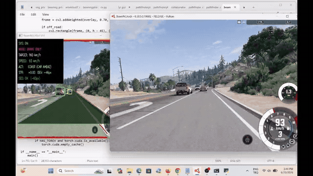 | 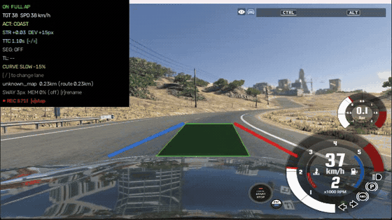 |
| **AEB Crash-Energy Mitigation:** Forced over-speeding approach at 90 km/h; system detects lead hazard, triggers emergency braking at 38m, and reduces impact speed to 35 km/h (**≈84.9% kinetic energy dissipated**). *(Simulated in BeamNG.tech).*<br>▶️ [`demo_sitl_beamng_level2_autopilot.mp4`](assets/videos/demo_sitl_beamng_level2_autopilot.mp4) | **Autonomous Curvature Steering & Closed-Loop Control:** Operating in **`ON FULL AP`** mode; tracks lane boundaries, executes active autonomous steering (`STR +0.05 DEV +32px`), dynamically applies curve deceleration (**`CURVE SLOW -18%`**), and straightens smoothly upon curve exit.<br>▶️ [`demo_sitl_beamng_full_autopilot_mountain_curve.mp4`](assets/videos/demo_sitl_beamng_full_autopilot_mountain_curve.mp4) |

---

### Real-World Vision & Deep Learning Perception Previews

| Full HD Dual-Network Perception (TwinLiteNet + YOLOv12s) | Perpendicular Intersection T-Bone Cut-In (`5.8m TTC 0.0s`) |
|:---:|:---:|
| 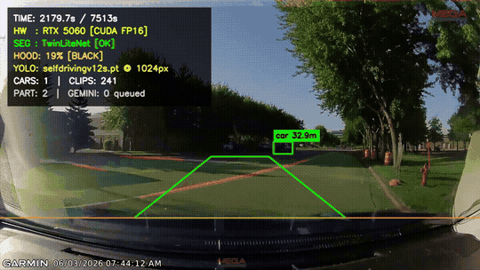 | 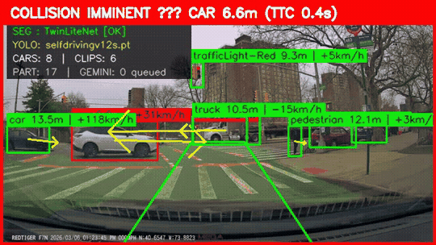 |
| **1080p Dual-Model Perception Stack:** Real-time CUDA FP16 inference running TwinLiteNet road segmentation mask (drivable corridor) merged with YOLOv12s multi-target detection, distance estimation, and dynamic motion vectors on RTX 5060.<br>▶️ [`demo_13_yt_perception_twinlitenet_yolo12s.mp4`](assets/videos/demo_13_yt_perception_twinlitenet_yolo12s.mp4) | **High-Risk Cross-Traffic Arbitration:** Red commercial truck crosses host path perpendicularly at +72 km/h; system instantly triggers flashing red alert banner (**`COLLISION IMMINENT ??? CAR 5.8m (TTC 0.0s)`**) with simultaneous pedestrian arbitration at 7.4m.<br>▶️ [`demo_12_yt_fcw_tbone_intersection_red_truck.mp4`](assets/videos/demo_12_yt_fcw_tbone_intersection_red_truck.mp4) |

| Adverse Direct Sun Glare (`107 km/h`) | Residential Approach & Predictive Swerve Crash |
|:---:|:---:|
| 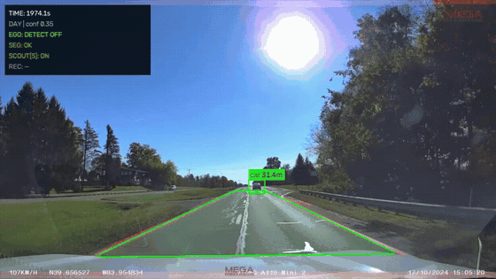 | 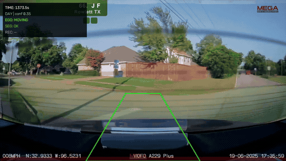 |
| **Severe Low-Angle Sun Glare:** Host vehicle traveling at **107 km/h** facing direct blinding sun glare; lead SUV is continuously tracked at 23.4m with timely deceleration alert.<br>▶️ [`demo_fcw_sun_glare_highspeed_107kmh.mp4`](assets/videos/demo_fcw_sun_glare_highspeed_107kmh.mp4) | **Predictive Suspension Roll & Swerve Trajectory:** Oncoming sedan approaches at 18 mph; as the driver steers hard left, right-half suspension compresses under lateral roll. The system instantly computes the hard steer vector into the host corridor, triggers **`RED - EMERGENCY BRAKE`**, and predicts incursion before impact.<br>▶️ [`demo_fcw_residential_two_lane_swerve_crash.mp4`](assets/videos/demo_fcw_residential_two_lane_swerve_crash.mp4) |

| Night Urban Wet Asphalt Deceleration (`52 km/h`) | Signalized Intersection Left-Turn Truck (`43 mph`) |
|:---:|:---:|
| 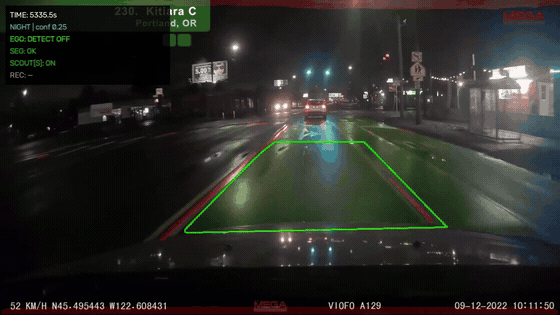 | 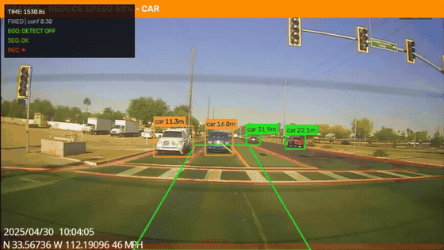 |
| **Adverse Night Conditions:** Driving at 52 km/h on wet asphalt with street glare; lead SUV detected at 7.2m with instantaneous **`RED - EMERGENCY BRAKE`** trigger.<br>▶️ [`demo_fcw_night_wet_asphalt_braking.mp4`](assets/videos/demo_fcw_night_wet_asphalt_braking.mp4) | **Traffic Light & Cross-Turn Arbitration:** Enters intersection under **`trafficLight-Green`** at 43 mph; oncoming pickup turns across host path, triggering emergency brake banner.<br>▶️ [`demo_fcw_intersection_imminent_brake.mp4`](assets/videos/demo_fcw_intersection_imminent_brake.mp4) |

---

## Master Demonstration Video Library

All complete demonstration recordings with full telemetry overlays are available in [`assets/videos/`](assets/videos/):

| Video Clip | Description | Resolution & Mode |
|:---|:---|:---:|
| ⭐ [`ADAS_ORET_Community_Showcase_Full_1080p.mp4`](assets/videos/ADAS_ORET_Community_Showcase_Full_1080p.mp4) | Master Compilation Video combining real-world deep learning perception with BeamNG.tech simulation dynamics. | `1080p Full HD` (2m 14s) |
| 📱 [`ADAS_Instagram_Story_9x16.mp4`](assets/videos/ADAS_Instagram_Story_9x16.mp4) | Vertical Mobile Story / Reels Showcase featuring BeamNG simulation scenarios with live telemetry cards. | `1080×1920 9:16` (52s) |
| [`sitl_08_beamng_overspeed_curve_esc_stabilization.mp4`](assets/videos/sitl_08_beamng_overspeed_curve_esc_stabilization.mp4) | Overspeed curve crash avoidance, custom ESC slide correction, and 100% emergency brake (92→61 km/h). | BeamNG Simulation |
| [`sitl_05_beamng_utah_highspeed_highway_bridge.mp4`](assets/videos/sitl_05_beamng_utah_highspeed_highway_bridge.mp4) | High-speed 74 km/h closed-loop autopilot cruise across Utah Canyon highway viaduct bridge. | BeamNG Simulation |
| [`sitl_06_beamng_utah_tunnel_lowlight_transit.mp4`](assets/videos/sitl_06_beamng_utah_tunnel_lowlight_transit.mp4) | Subterranean mountain tunnel low-light high-speed transit at 71 km/h with continuous lane lock. | BeamNG Simulation |
| [`demo_sitl_beamng_teknofest_robotaksi_obstacle_avoidance_turn_park.mp4`](assets/videos/demo_sitl_beamng_teknofest_robotaksi_obstacle_avoidance_turn_park.mp4) | TEKNOFEST Robotaksi digital twin: dynamic obstacle detour, 90° intersection turn, and automated parking. | BeamNG Simulation |
| [`demo_sitl_beamng_full_autopilot_mountain_curve.mp4`](assets/videos/demo_sitl_beamng_full_autopilot_mountain_curve.mp4) | Full autonomous autopilot speed limit negotiation, curve slowdown, and steering on mountain highway. | BeamNG Simulation |
| [`demo_sitl_beamng_full_autopilot_coastal_course.mp4`](assets/videos/demo_sitl_beamng_full_autopilot_coastal_course.mp4) | 47-second continuous closed-loop autopilot navigating winding coastal curves with dynamic curve slowing. | BeamNG Simulation |
| [`demo_sitl_beamng_level2_autopilot.mp4`](assets/videos/demo_sitl_beamng_level2_autopilot.mp4) | BeamNG.tech Level 2 closed-loop intervention (target-occlusion and crash-energy mitigation, 90→35 km/h). | BeamNG Simulation |
| [`demo_sitl_beamng_lane_centering_stop.mp4`](assets/videos/demo_sitl_beamng_lane_centering_stop.mp4) | Closed-loop lane centering, drivable corridor segmentation, and automated safe stopping behind lead traffic. | BeamNG Simulation |
| [`demo_13_yt_perception_twinlitenet_yolo12s.mp4`](assets/videos/demo_13_yt_perception_twinlitenet_yolo12s.mp4) | High-resolution 1080p dual-network perception pipeline (TwinLiteNet road segmentation + YOLOv12s object tracking). | Real-World Vision |
| [`demo_12_yt_fcw_tbone_intersection_red_truck.mp4`](assets/videos/demo_12_yt_fcw_tbone_intersection_red_truck.mp4) | Perpendicular intersection T-bone crossing truck with flashing collision alert banner and pedestrian detection. | Real-World Vision |
| [`demo_fcw_sun_glare_highspeed_107kmh.mp4`](assets/videos/demo_fcw_sun_glare_highspeed_107kmh.mp4) | High-speed highway following at 107 km/h driving directly into blinding low-angle sun glare. | Real-World Vision |
| [`demo_fcw_longitudinal_rear_end.mp4`](assets/videos/demo_fcw_longitudinal_rear_end.mp4) | High-speed highway following, closing-distance calculation, and imminent braking warning. | Real-World Vision |
| [`demo_fcw_merging_cutin_threat.mp4`](assets/videos/demo_fcw_merging_cutin_threat.mp4) | Aggressive lateral cut-in threat detection with predictive trajectory vector projection. | Real-World Vision |
| [`demo_fcw_commercial_driveway_incursion.mp4`](assets/videos/demo_fcw_commercial_driveway_incursion.mp4) | Vehicle pulling out perpendicularly from a commercial entrance with predictive trajectory vector alert. | Real-World Vision |
| [`demo_fcw_highway_traffic_lead_slowdown.mp4`](assets/videos/demo_fcw_highway_traffic_lead_slowdown.mp4) | Multi-lane highway dense traffic with lead SUV braking event and ego corridor tracking. | Real-World Vision |
| [`demo_fcw_intersection_imminent_brake.mp4`](assets/videos/demo_fcw_intersection_imminent_brake.mp4) | Signalized intersection left-turn truck collision alert under active green traffic light (43 mph). | Real-World Vision |
| [`demo_fcw_residential_two_lane_swerve_crash.mp4`](assets/videos/demo_fcw_residential_two_lane_swerve_crash.mp4) | Residential two-lane oncoming vehicle hard steer, suspension roll compression, and collision trajectory prediction. | Real-World Vision |
| [`demo_fcw_night_wet_asphalt_braking.mp4`](assets/videos/demo_fcw_night_wet_asphalt_braking.mp4) | Nighttime urban driving with road reflections and lead vehicle emergency braking. | Real-World Vision |
| [`demo_fcw_oncoming_lane_incursion.mp4`](assets/videos/demo_fcw_oncoming_lane_incursion.mp4) | Oncoming vehicle centerline lane encroaching hazard alert at 37 mph. | Real-World Vision |
| [`demo_fcw_urban_lead_brake_pedestrian_detection.mp4`](assets/videos/demo_fcw_urban_lead_brake_pedestrian_detection.mp4) | Close-proximity lead vehicle emergency brake (2.2m) with simultaneous roadside pedestrian detection. | Real-World Vision |

---

## Why This Project

Most older vehicles lack modern driver-assistance technology, as factory-installed ADAS remains expensive, proprietary, and un-retrofittable. This project develops a **low-cost, high-reliability embedded ADAS suite** acting as an intelligent co-pilot for the two most safety-critical operating modes: **forward driving** and **reverse parking**.

### Code & Architecture Status

The core source code, trained model weights, and proprietary firmware are currently **in active private research and development**. This repository serves as the official technical documentation, architecture specification, and benchmarking report. Public open-source code releases will follow embedded hardware hardening and physical road verification.

---

## System Architecture & Hardware Nodes

The system operates across three interconnected tiers: a **Simulation-in-the-Loop Node** for closed-loop dynamic validation, a **Laptop Perception Node** for real-car multi-sensor processing, and a **Raspberry Pi Embedded Node** for in-cabin driver monitoring and physical automotive I/O.

```mermaid
flowchart TD
    subgraph SENSORS ["Visual & Telemetry Sensors"]
        ZED["Stereolabs ZED 2 / ZED 2i\nStereo Camera (Sub-Pixel NCC)"]
        CUBE["Cube Orange + Dual Here 3 GNSS\nMAVLink USB (EKF Speed + IMU Yaw)"]
        DMS_CAM["Driver-Facing Camera\n(USB / Picamera2)"]
        LDR["LDR Ambient Light Sensor\n+ MCP3008 ADC"]
        SONAR["4× JSN-SR04T Waterproof\nUltrasonic Sensors"]
        REV_SIG["12V Reverse Signal\n-> Optocoupler"]
    end

    subgraph RPI_NODE ["Raspberry Pi Embedded Node (Bookworm 64-bit)"]
        DMS["Driver Monitoring System (DMS)\nMediaPipe Face Mesh (EAR, PERCLOS, MAR)"]
        TOUCH["7\" Waveshare Touchscreen UI\n(1024×600 Interactive HUD)"]
        RELAY["Dual Hysteresis Headlight Relay\n(30% ON / 50% OFF)"]
        CUTOFF["L298N Actuator Cutoff\n(Engine Shutdown on >5s Micro-Sleep)"]
        UDP_PUB["UDP Telemetry Broadcaster\n(Port 5005 -> Driver State)"]
        MJPEG["HTTP MJPEG Video Server\n(Port 8080 -> Driver Stream)"]
    end

    subgraph LAPTOP_NODE ["Real-Car Perception Node (zed2_realcar_adas4.py)"]
        STEREO_ENG["Metric Stereo Depth Engine\nDense Disparity + StereoSGBM + NCC"]
        FUSION["Cube Orange EKF Speed &\nIMU Yaw-Rate Road Curvature Fusion"]
        YOLO_TRT["YOLOv12s / RT-DETR\nTensorRT FP16 Engine (RTX 5060)"]
        TWIN["TwinLiteNet Drivable Segmentation\n(CUDA FP16 Above-Hood Tensor)"]
        FCW_ENG["Kinematic FCW & Kalman Filter\n(TTC, Cut-In, T-Bone & Ego Corridor)"]
        PI_SUB["PiStateListener\n(Ingests Driver State -> Boosts FCW)"]
        LIVE_HUD["Real-Time Augmented HUD\nLaser Rangefinder Probe & Alerts"]
    end

    subgraph BEAMNG_NODE ["Closed-Loop Simulation Node (beamng_pilot_v31)"]
        SIM_API["BeamNG.tech Physics Bridge\n(Sensors, Steering & Braking)"]
        QUINTIC["Quintic Min-Jerk Trajectory Planner\nS(t) = 10t³ - 15t⁴ + 6t⁵"]
        ESC_SYS["Dynamic 2-DOF Active ESC\n(Counter-Steer & Stability Braking)"]
        SHADOW["Touch-Free Shadow Mode & RL Engine\n(Records Human vs AI & Rewards)"]
    end

    ZED --> STEREO_ENG
    CUBE --> FUSION
    DMS_CAM --> DMS
    LDR --> RELAY
    DMS --> TOUCH & CUTOFF & UDP_PUB & MJPEG
    
    UDP_PUB -. Direct Ethernet (192.168.50.x) .-> PI_SUB
    PI_SUB --> FCW_ENG

    STEREO_ENG & FUSION & YOLO_TRT & TWIN --> FCW_ENG
    FCW_ENG --> LIVE_HUD

    SIM_API --> QUINTIC & ESC_SYS & SHADOW
```

---

## Real-World ZED 2 + Cube Orange Perception Architecture

The physical vehicle testing tier (`zed2_realcar_adas4.py`) implements a complete SAE Level 0 driver warning and telemetry fusion pipeline on passenger vehicles (e.g. Honda Civic), integrating sub-pixel stereo disparity with Cube Orange GNSS/IMU navigation:

### Real-Life SAE Level 0 ADAS Capabilities
- **Sub-Pixel Metric Stereo Rangefinder:** Epipolar rectification using factory calibration parameters, multi-band 1D Parabolic Sub-Pixel NCC refiner with **~0.02 px precision** (delivering centimeter-level 0.01m accuracy under 15m), and live mouse click-to-measure 3D rangefinder probe.
- **Cube Orange + Dual Here 3 GNSS Fusion:** MAVLink USB auto-probing connection (automatically skips SLCAN port), EKF ground speed, heading, 3D/RTK satellite fix quality, and IMU-derived road curvature compensation.
- **Predictive Warning Suite:** Forward Collision Warning (FCW), Headway Monitoring Warning (HMW), Stopped-Ego Hysteresis, Lead Vehicle Departure Alert (LVDA), Cut-In & T-Bone cross-traffic detection, and Lane Departure Warning (LDW).
- **Raspberry Pi Telemetry Ingestion:** Decoupled `PiStateListener` listens on UDP port 5005; when the in-cabin driver monitor flags drowsiness or inattention, FCW thresholds automatically expand (`--pi-boost`) to provide earlier warnings.

---

## Project Evolution & Version History (V1 – V31)

Over 1.5 years of continuous engineering (late 2025 to late 2026), the system progressed from basic screen-captured keyboard actuation to an industrial-grade, multi-domain autonomous driving and safety perception ecosystem.

```
                                                        CHRONOLOGICAL DEVELOPMENT ROADMAP
 2025 Q4 - 2026 Q1          2026 Q2                     2026 Q3                     2026 Q3 - Q4                     2026 Q4 (CURRENT)
┌────────────────────┐   ┌────────────────────────┐   ┌─────────────────────────┐   ┌──────────────────────────┐   ┌──────────────────────────────┐
│   ERA 1 (V1 - V2)  │   │   ERA 2 (V3 - V10)     │   │   ERA 3 (V11 - V15)     │   │   ERA 4 & 5 (V16 - V27)  │   │   ERA 6 (V28 - V31)          │
│ • Proof-of-concept │──▶│ • BeamNG Native API    │──▶│ • Deep Learning (YOLO12)│──▶│ • Metric BEV Polynomials │──▶│ • Quintic Min-Jerk Overtakes │
│ • Screen scraping  │   │ • Continuous Steering  │   │ • TwinLiteNet RoadSeg   │   │ • Active ESC & 3D LiDAR  │   │ • V31 PRO Shadow Mode & RL   │
│ • Discrete keys    │   │ • Stanley Path Tracker │   │ • Anti-Phantom Debounce │   │ • Monolithic V27 Release │   │ • ZED 2 + Cube Orange RealCar│
└────────────────────┘   └────────────────────────┘   └─────────────────────────┘   └──────────────────────────┘   └──────────────────────────────┘
```

| Era / Version Range | Architectural Paradigm | Key Capabilities & Milestones Added | Critical Engineering Bottlenecks Diagnosed & Solved |
| :--- | :--- | :--- | :--- |
| **Era 1: Proof-of-Concept<br>(V1 – V2)** | Screen Capture (`mss`) + OpenCV Canny/Hough + Keyboard Actuation | • First closed-loop steering in BeamNG.<br>• Discrete bang-bang keyboard actuation (`'a'` / `'d'`).<br>• MediaPipe in-cabin driver drowsiness detection (EAR). | **Latency & Buffer Bloat:** Fixed keyboard emulation queue delays by setting zero-pause execution; established baseline feasibility of vision-guided steering. |
| **Era 2: Native Physics API & Lateral Stabilization<br>(V3 – V10)** | BeamNG.tech Native API (`beamngpy`) + Virtual Camera + Analog Actuation | • Continuous floating-point steering (`vehicle.control`).<br>• Stanley geometric path-tracking implementation.<br>• "The Ultimate Hybrid": 60 FPS screen capture paired with native analog steering. | **Oversteer & Frame Drops:** Overcame virtual camera render overhead via hybrid capture; tuned soft-body lateral damping to eliminate high-speed pendulum fishtailing. |
| **Era 3: Deep Neural Perception & AEB Gating<br>(V11 – V15)** | Hybrid Vision + TwinLiteNet (`nano.pth`) + YOLOv12s + ByteTrack | • Dual-head road segmentation (Drivable Area + Lane Lines at 640×384).<br>• Multi-tier Forward Collision Warning state machine.<br>• RT-DETR vs YOLO benchmarking.<br>• In-corridor polygon threat gating. | **Phantom AEB & ROI Interference:** Gated cross-lane oncoming traffic to eliminate false emergency braking; masked out in-cockpit digital speedometer rings that mimicked road lines. |
| **Era 4: Predictive Curvature Feedforward & 3D LiDAR<br>(V16 – V23)** | Multi-Horizon Sampling + GPS Spatial Hash (`RoadMemory`) + 64-Ch LiDAR | • Multi-depth lookahead horizon sampling (near, mid, far).<br>• Proactive Ackermann curvature feedforward steering.<br>• Spatial hash road memory and 60 Hz synchronous blackbox (`RoadDataLogger`).<br>• 64-channel 360° roof LiDAR with 72-sector polar HUD radar. | **Curve Understeer & Darkness Washout:** Replaced reactive steering with anticipatory curve entry; maintained sensor contrast across dusk/dawn transitions; immune to dense fog via 3D LiDAR. |
| **Era 5: Mountain Pavement Fallback & Metric BEV<br>(V24 – V27)** | Orthographic Inverse Perspective Mapping (BEV) + 2-DOF ESC + Monolithic Core | • Pavement right-border asphalt tracking (`compute_roadseg_fallback_deviation`) for unpainted mountain descents.<br>• Bird's-Eye-View 2nd-order polynomial fitting ($x = ay^2 + by + c$).<br>• 2-DOF linear bicycle model Active Electronic Stability Control (ESC).<br>• Monolithic 8,000-line production autopilot (`beamng_pilot_v27.py`). | **Slalom Hunting & Cliff Drops:** Fully eradicated lateral limit-cycle oscillations ("slalom") via metric BEV; enabled cliff-side navigation on roads without painted lines; zero optical jumping. |
| **Era 6: Utah Loop, Quintic Overtakes & Shadow Mode<br>(V28 – V31)** | Quintic Min-Jerk Trajectory + Lead Kalman Filter + 2-DOF ESC + Touch-Free Shadow Recorder | • **Utah Highway + Mountain Tunnel Loop (V29):** First 100% crash-free closed-loop loop completed with and without AI traffic; withstands 1–2s tunnel portal camera blowout.<br>• **Active High-Speed Curve ESC:** Oversteer counter-steer, understeer authority boost, and extreme overspeed curve stabilization (92 → 61 km/h).<br>• **Quintic Minimum-Jerk Overtakes (V31 Baseline):** Smooth $S(t) = 10t^3 - 15t^4 + 6t^5$ trajectory, speed-adaptive lookahead (55–85m), bilateral passing, and authority softening.<br>• **V31 PRO Shadow Mode:** Touch-free background recording of human inputs vs AI shadow calculations for imitation and reinforcement learning. | **Violent Lateral Jerk & Tunnel Blindness:** Solved tunnel entry camera exposure lag via curvature retention; eradicated violent lateral lane-change snaps using $C^2$ continuous minimum-jerk trajectory synthesis. |

---

## Performance Benchmarks (113 Manually Reviewed Scenarios)

The vision perception and FCW stack were evaluated across **113 diverse real-world crash and near-miss scenarios** spanning highway, urban, low-light, and adverse weather conditions. A warning was considered timely if issued at least **1.5s** before impact or critical conflict.

### Table II: Scenario-Specific Detection Accuracy

| Scenario Type | Total ($N$) | Timely Warnings | Late / Missed | Timely-Warning Rate (95% CI) |
|:---|:---:|:---:|:---:|:---:|
| **Longitudinal (Rear-End)** | 50 | 47 | 3 | **94.0%** (83.8–97.9%) |
| **Lateral (T-Bone / Intersection)** | 29 | 14 | 15 | **48.3%** (31.4–65.6%) |
| **Lane Cut-Ins (Partial Object)** | 22 | 6 | 16 | **27.3%** (13.2–48.2%) |
| **Nighttime / Low-Light** | 12 | 1 | 11 | **8.3%** (1.5–35.4%) |
| **TOTAL** | **113** | **68** | **45** | **60.2%** (51.0–68.7%) |

- **Nuisance Alerts:** **5 of 113 cases (4.4%)** — occurring exclusively when adjacent vehicles overtook the host car at close lateral distance.

<details>
<summary><b>Click to expand 113 Crash & Near-Miss Scenario Photo Gallery</b></summary>

<br>

#### 1. Longitudinal Forward Collisions & Lead Vehicle Deceleration
| Lead SUV Close Proximity (`2.9m`) | High-Speed Sun Glare (`107 km/h`) | Residential Two-Lane Approach |
|:---:|:---:|:---:|
| 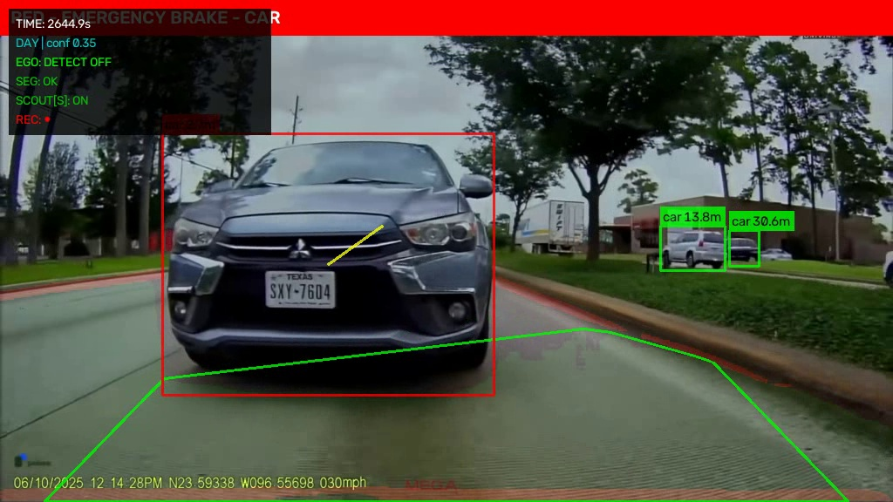 | 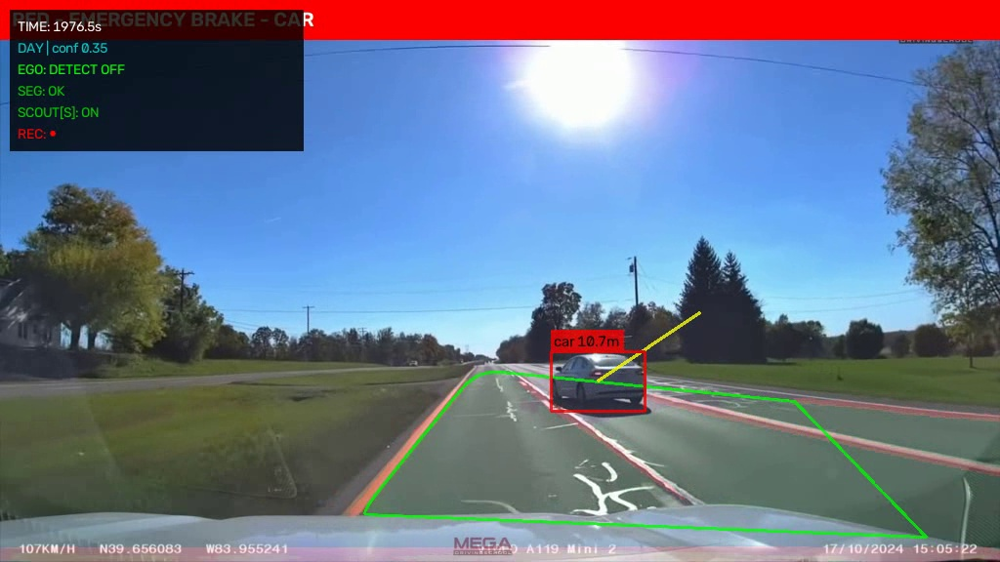 | 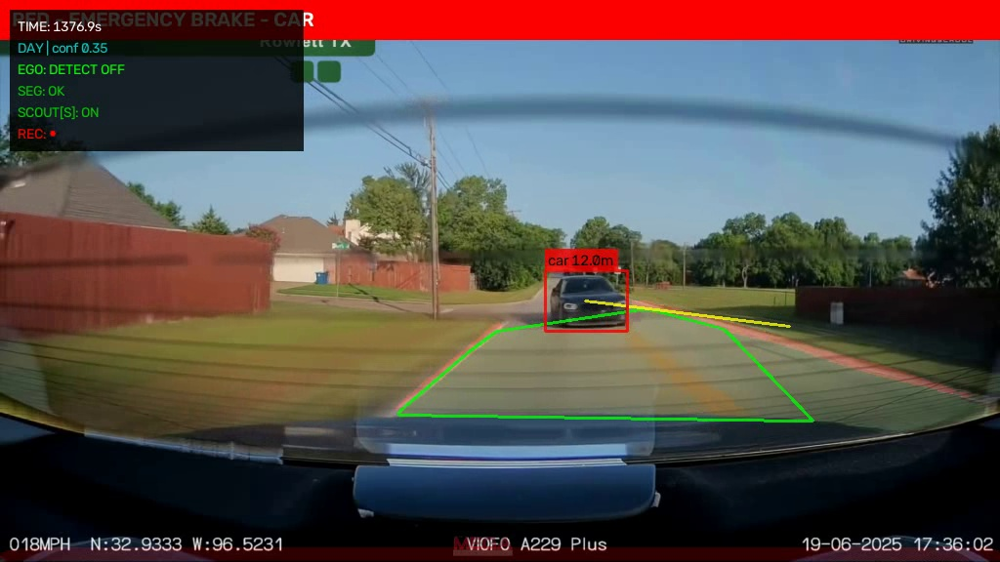 |
| **`car 2.9m`** in RED box triggering **`RED - EMERGENCY BRAKE`**. | High-speed following at **107 km/h** driving into blinding sun glare (**`car 10.7m`**). | Suburban approach to lead vehicle (**`car 12.0m`**) with ego corridor overlay. |

#### 2. Lateral Cross-Traffic & Intersection T-Bone Hazards
| Signalized Intersection Cross-Traffic | Intersection Impact / Damaged Hood | Urban Avenue Red Beetle Crossing |
|:---:|:---:|:---:|
| 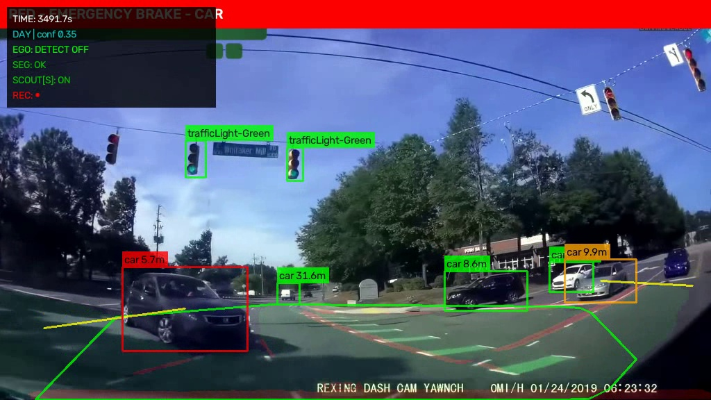 | 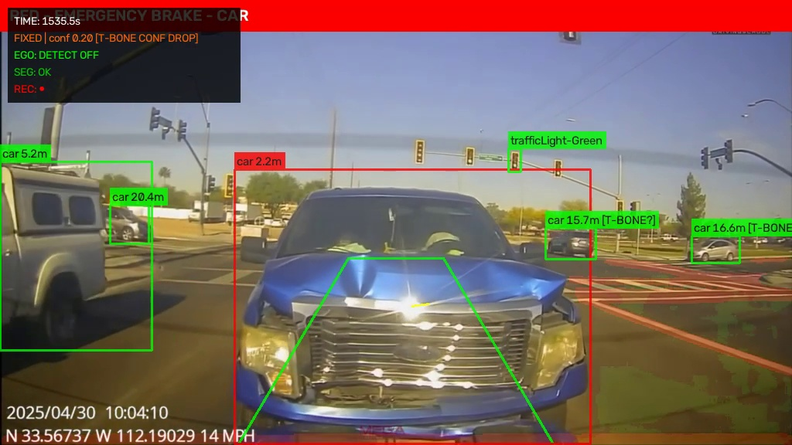 | 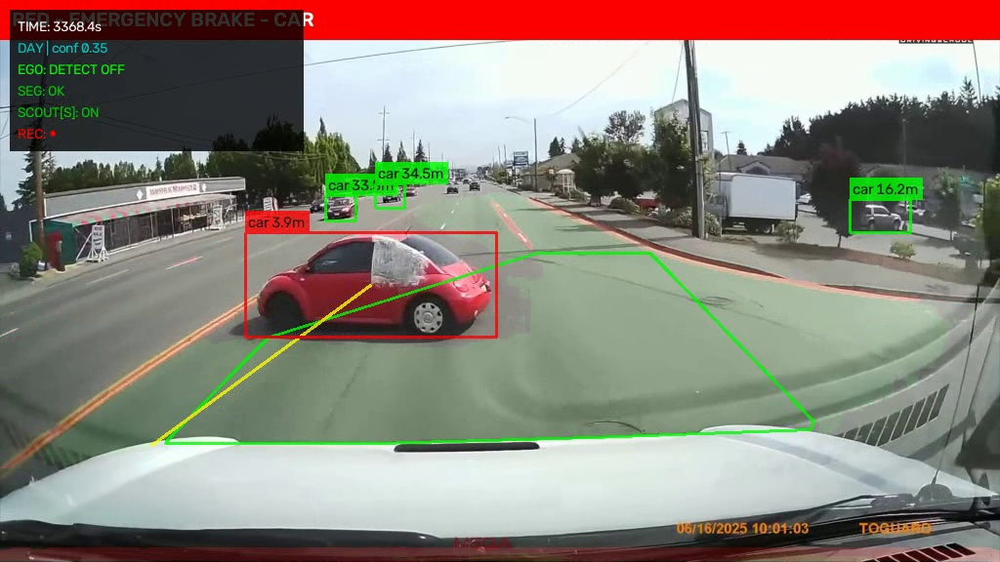 |
| Black sedan traversing signalized intersection perpendicularly (**`car 6.2m`**). | Blue pickup truck with crumpled hood at intersection crossing (**`car 1.9m`**). | Red VW Beetle crossing urban commercial avenue perpendicularly (**`car 3.9m`**). |

#### 3. Lateral Merging, Cut-Ins & Vehicle Incursions
| Aggressive Perpendicular Merge | Highway Ramp Merging Incursion | Rural Highway Crossroad Pull-Out |
|:---:|:---:|:---:|
| 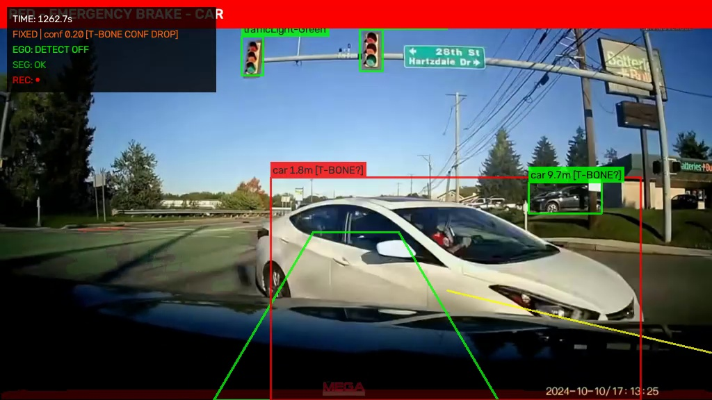 | 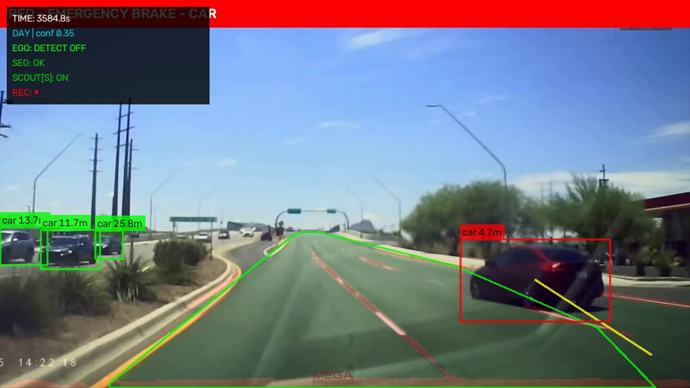 | 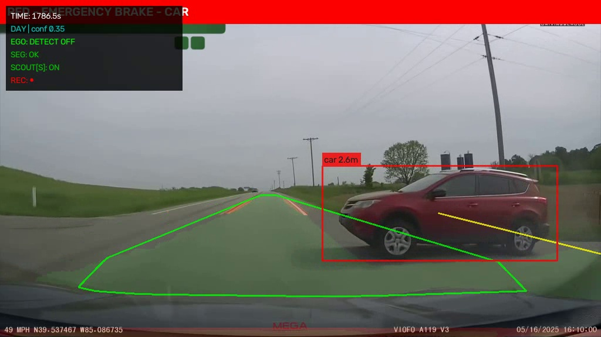 |
| **`car 12.2m [T-BONE?]`** turning into host lane; proactively flagged with active **`EMERGENCY BRAKE`**. | Dark sedan merging into curved highway ramp from right shoulder (**`car 4.7m`**). | Red SUV pulling out perpendicularly from roadside at 49 mph (**`car 2.6m`**). |

#### 4. Adverse Lighting & Dense Multi-Target Urban Environments
| Nighttime Urban Streetlight Driving | Rear-End Impact Bumper Damage | Dense Palm-Tree Avenue Crosswalk |
|:---:|:---:|:---:|
| 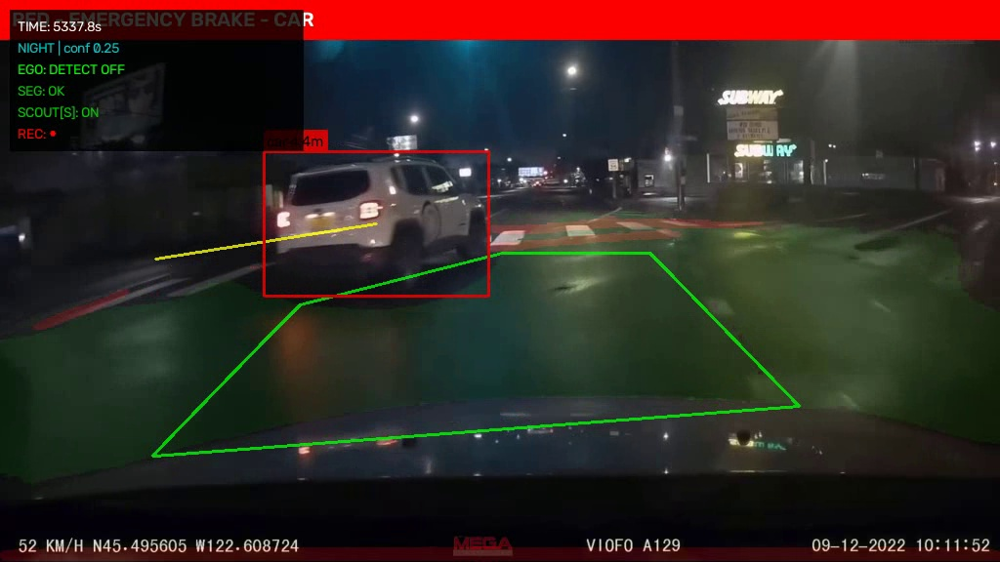 | 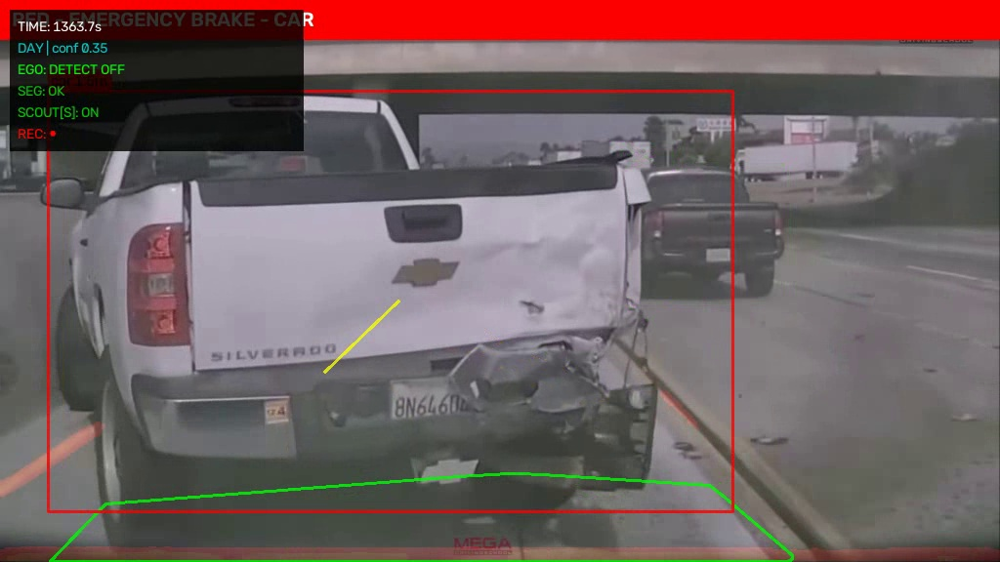 | 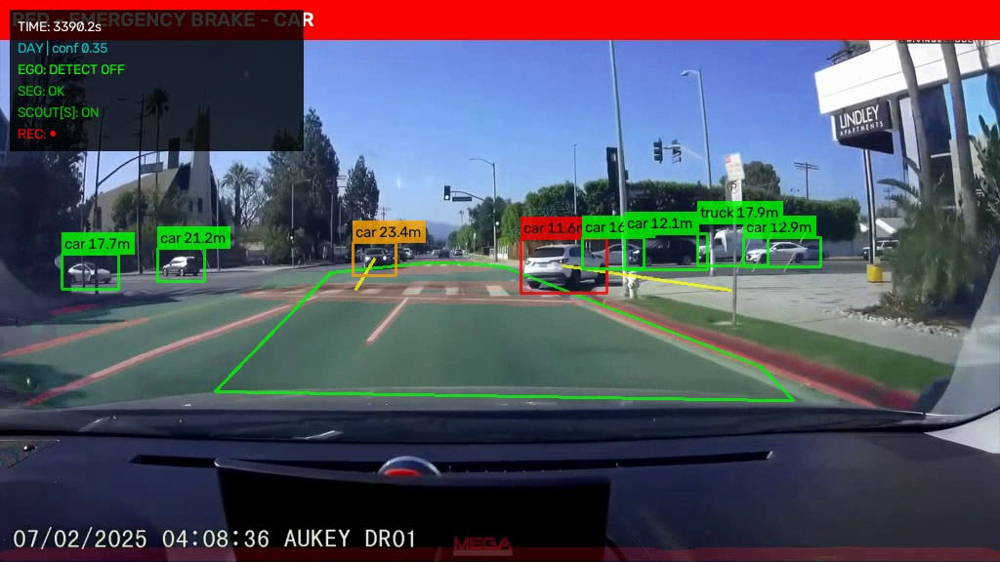 |
| True nighttime urban driving at 52 km/h under streetlights (**`car 4.4m`**). | Immediate proximity to damaged tailgate under highway overpass (**`car 1.6m`**). | High-density urban avenue with **7 surrounding vehicles tracked simultaneously**. |

</details>

---

## Automated Benchmark (2,844 Nexar-Derived Sequences)

Seven vision-pipeline configurations were compared across 2,844 processed sequences derived from the [Nexar dashcam collision dataset](https://arxiv.org/abs/2503.03848).

| Configuration | Recall / Sensitivity | False Alarm Rate | F1-Score | Nighttime Acc. |
|:---|:---:|:---:|:---:|:---:|
| **Config 01 - CPU baseline** (raw pinhole distance) | 89.80% | 77.08% | 67.69% | 60.32% |
| **Config 11 - balanced optimum** (conf=0.35) | 90.72% | 76.04% | **68.22%** (highest F1) | 63.49% |
| **Config 17 - high recall** (TwinLiteNet, 640×384) | **92.50%** (highest recall) | 80.83% | 67.68% | **63.64%** (highest night acc.) |

*(Note: The automated scoring script marks any alert without an actual physical collision as a false positive. Because the Nexar dataset predominantly consists of near-miss events where drivers braked in time, the automated false-alarm rate is mathematically elevated compared to the true 4.4% nuisance-alert rate measured in manual review).*

---

## Custom-Trained YOLO12s Models

Two 9.26-million-parameter **YOLO12s** models were trained at 1024×1024 resolution on an RTX 5060 GPU:

| Model | Classes | Training | Validation mAP@50 | Validation mAP@50-95 |
|:---|:---:|:---|:---:|:---:|
| **Turkish Traffic Sign Detector** | 24 | 85 epochs (50 initial + 35 fine-tuning) | **93.47%** | 73.11% |
| **Self-Driving / Road-Object Detector** | 7 | Reduced Roboflow base set + custom dashcam additions | **94.75%** | — |

---

## Android Companion App

A companion Android application (Kotlin / Jetpack Compose) extends the perception architecture to smartphones:

- **CameraX + TensorFlow Lite** inference cascade: GPU → NNAPI → CPU on-device fallback.
- **11 detected classes** with class-aware Non-Maximum Suppression (NMS).
- Live **SAFE / CAUTION / WARNING / CRITICAL** threat evaluation with dynamic TTC.

<div align="center">
  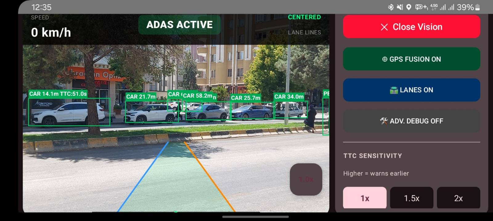
</div>

---

## Bill of Materials (BOM)

### Prototype Hardware Implementation

| Component | Specification | Est. Cost (EUR) |
|:---|:---|:---:|
| **Compute Module** | Raspberry Pi 5 (16 GB RAM) + Active Cooler | €145 |
| **AI Acceleration** | Hailo-10H M.2 Module (~40 TOPS, INT4) + M.2 HAT+ Adapter | €140 |
| **Visual Sensors** | 2× USB 1080p Wide-Angle Cameras + 1× USB 720p Rear Camera | €100 |
| **Display** | 7-inch Capacitive Touchscreen (DSI/HDMI) | €65 |
| **Proximity Sensors** | 4× JSN-SR04T Waterproof Ultrasonic Sensors | €45 |
| **Power Management** | 12V-to-5V 5A Buck Converter + Optoisolated Relay Module | €25 |
| **Peripherals** | MCP3008 ADC, Wiring Harness, Enclosure, PCB | €30 |
| **TOTAL** | | **€545** |

---

## Related Publication

This repository accompanies the following peer-reviewed proceedings paper (**officially accepted by MDPI, Basel, Switzerland**):

> **Design and Simulation Evaluation of an Embedded Multi-Sensor ADAS Architecture with AI-Assisted Collision Warning**  
> Ramazan Ertuğrul Aydoğan, Fatima Sapundzhi  
> **Status:** Accepted (Submission ID: `Sciforum-195321`) — To be presented at the 13th International Electronic Conference on Sensors and Applications (ECSA-13), Session S4: *Sensors and Artificial Intelligence*, 18–20 November 2026  
> *Engineering Proceedings* (MDPI AG, Basel, Switzerland, ISSN: 2673-4591)

```bibtex
@inproceedings{aydogan2026adas,
  author    = {Aydo{\u{g}}an, Ramazan Ertu{\u{g}}rul and Sapundzhi, Fatima},
  title     = {Design and Simulation Evaluation of an Embedded Multi-Sensor ADAS Architecture with AI-Assisted Collision Warning},
  booktitle = {Proceedings of the 13th International Electronic Conference on Sensors and Applications (ECSA-13)},
  series    = {Engineering Proceedings},
  publisher = {MDPI AG},
  address   = {Basel, Switzerland},
  year      = {2026},
  month     = {11},
  note      = {Accepted for publication (Sciforum-195321)},
  url       = {https://sciforum.net/event/ecsa-13}
}
```

---

## Academic Context, Supervision & Acknowledgements

This project was initiated independently by the author to advance autonomous systems capabilities for **ORET (Otomobil, Robot ve Enerji Topluluğu)** and conduct peer-reviewed academic research. As the engineering scope matured, it was formalized and submitted as the senior capstone project for the **EEE499 Graduation Project** in the **Department of Electrical and Electronics Engineering, Gaziantep University (GAÜN)**.

The project was carried out under the academic supervision of **Prof. Dr. Uğur Cem Hasar**, under whose supervision the author conducts academic research. Simulation-in-the-loop (SITL) validation was conducted using **BeamNG.tech** under an academic research license generously provided by **BeamNG GmbH**.

### BeamNG.tech Academic Research License

<p align="left">
  
  &nbsp;&nbsp;&nbsp;&nbsp;
  
</p>

Special thanks and sincere gratitude to **BeamNG GmbH** for providing an academic research license for **BeamNG.tech**. The high-fidelity soft-body physics and software-in-the-loop environment were essential for validating autonomous emergency braking, trajectory tracking, high-speed ESC stability, and obstacle overtaking architectures.

### Hardware & Laboratory Support — ORET

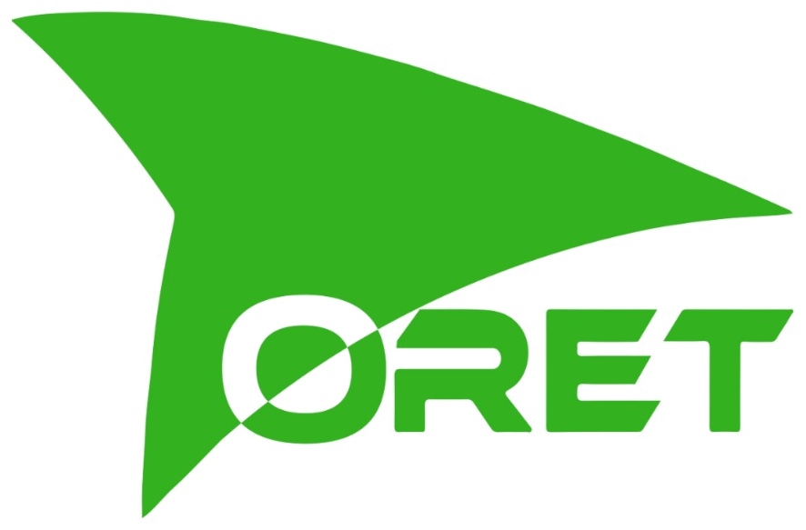

Special thanks to **ORET (Otomobil, Robot ve Enerji Topluluğu / Automotive, Robotics and Energy Society)** at **Gaziantep University (GAÜN)** for laboratory access and essential electronic components—including the Raspberry Pi single-board computer, ultrasonic distance sensors, discrete semiconductors, and prototyping hardware.

---

## About the Lead Developer

**Ramazan Ertuğrul Aydoğan** — B.Sc., Electrical and Electronics Engineering, Gaziantep University (GAÜN)

Sole system architect and lead developer of this end-to-end ADAS & autonomous driving suite:
- **IEEE Best Paper Award** (Student Category), 2026 IEEE International Conference on Advanced Topics on Measurements and Simulation (ATOMS 2026), Cluj-Napoca, Romania.
- Presenting author at international IEEE and MDPI conferences across Europe; session co-chair at ICETASI 2026, Greece.
- **Team Captain, ORET Autonomous Systems** (Gaziantep University) — directs autonomous UAV/UGV systems for national and international competitions.
- Lead telemetry and software engineer for ORET at the Shell Eco-marathon Europe & Africa 2025 (Silesia Ring, Poland).
- Dual Erasmus+ engineering scholar: Transilvania University of Brașov, Romania, and South-West University "Neofit Rilski," Blagoevgrad, Bulgaria (4.0 GPA semester).

**Contact:** [LinkedIn](https://www.linkedin.com/in/ramazan-ertu%C4%9Frul-aydo%C4%9Fan-807655252/)

---

## License

Distributed under the **MIT License**. See [`LICENSE`](LICENSE) for details.

---

<div align="center">


</div>
